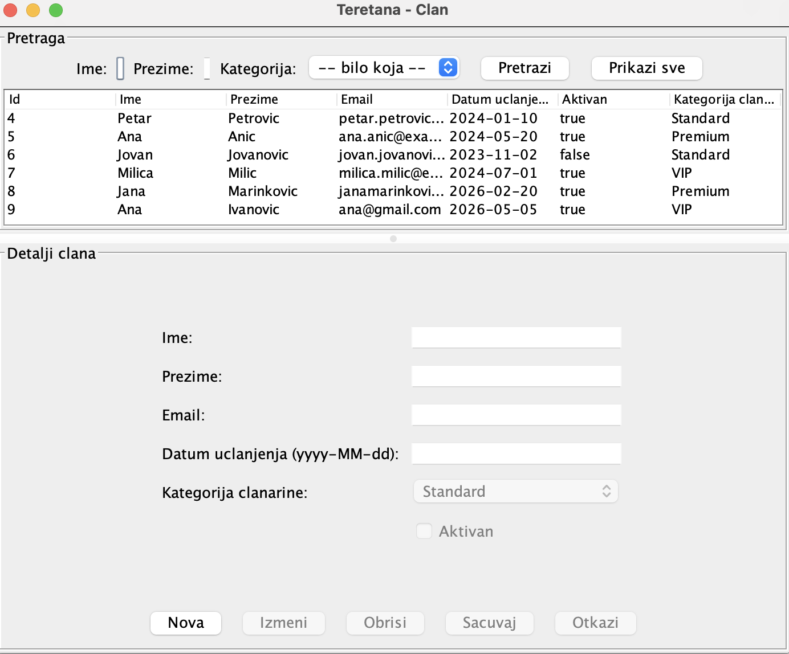
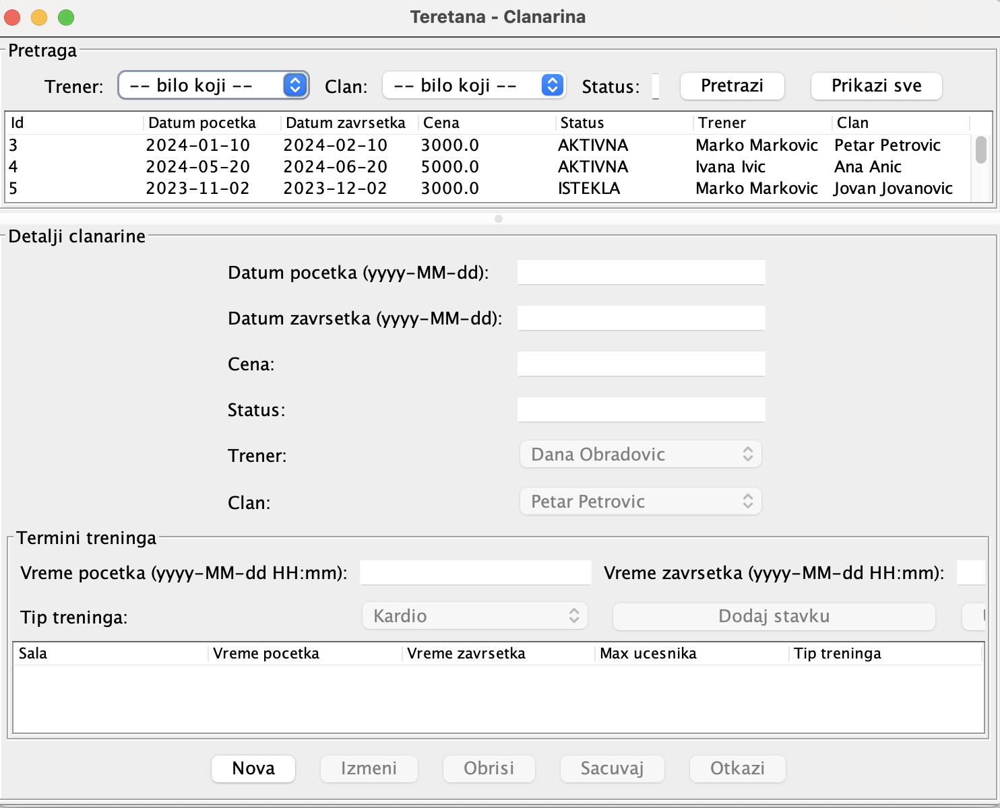
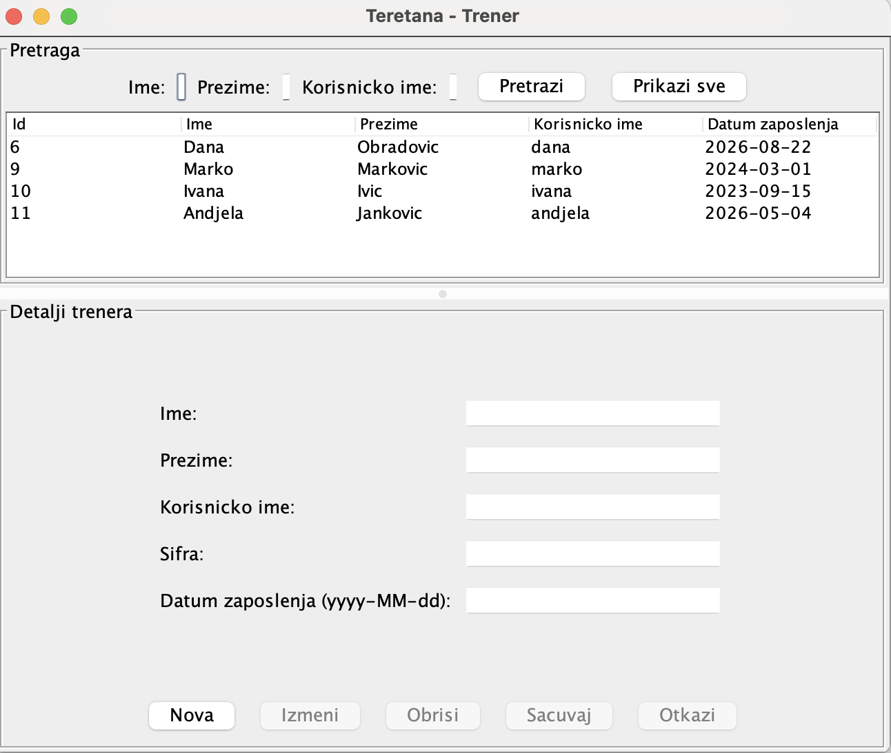

# Gym Management System

A Java desktop application developed as part of the Software Design course at the University of Belgrade, Faculty of Organizational Sciences.

The project demonstrates the design and implementation of a client-server application using Java, JDBC, and a relational MySQL database.

## Technologies

- Java
- Java Swing
- MySQL
- JDBC
- Apache NetBeans
- Apache Ant
- Git

## Project Structure

The application is organized into three NetBeans projects:

### TeretanaKlijent (Client)
Contains the desktop user interface, controllers, table models, and client-side communication.

### TeretanaServer (Server)
Handles client requests, executes system operations, applies business validation, and communicates with the database.

### TeretanaZajednicki (Common)
Contains shared domain models, communication classes, operation definitions, and exception classes.

## Functionality

The application includes functionality for:

- Managing gym members
- Managing trainers
- Creating and updating memberships
- Managing training programs and training types
- Searching and filtering records
- Communicating between client and server

## Architecture

The application follows a client-server architecture.

Client-server communication uses Java object serialization.

Business operations are implemented as separate system operation classes, following the Template Method pattern.

Database access is handled through JDBC, with transaction management and parameterized SQL statements.

## Database

The project uses MySQL and includes a relational database schema consisting of eight tables:

- Trener
- TipTreninga
- KategorijaClanarine
- ProgramTreninga
- Clan
- Clanarina
- TerminTreninga
- VodjenjeTreninga

The database schema is available in `sql/schema.sql`.

## Getting Started

### Requirements

- Java Development Kit (JDK)
- Apache NetBeans
- MySQL Server
- MySQL Connector/J 8.4.0

### Database Setup

1. Create a MySQL database named `teretana`.
2. Execute `sql/schema.sql` in that database.
3. In `TeretanaServer/src/server/config/`, copy `db.properties.example` to `db.properties`.
4. Update the database URL, username, and password in `db.properties`.

The real database configuration file is excluded from version control.

### Dependencies

Download MySQL Connector/J 8.4.0 and place the JAR file at:

`TeretanaServer/lib/mysql-connector-j-8.4.0.jar`

### Running the Application

1. Open the three projects in Apache NetBeans.
2. Build `TeretanaZajednicki`.
3. Build and run `TeretanaServer`.
4. Build and run `TeretanaKlijent`.
The server uses port `5555` by default.

## Project Status

Developed as an academic software engineering project.

The repository demonstrates client-server communication, relational database integration, and structured implementation of business operations.

## Application Screenshots

### Member Management
Search, view, create, update, and delete gym member records.

### Membership Management
Manage gym memberships, filter records by trainer, member, and status, and view associated training session details.

### Trainer Management
Search and manage trainer records through the Java Swing desktop interface.

